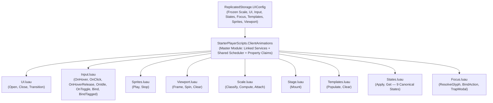

# RoUI Studio v2 — Pure-UI Architecture, Declarative Composer, & Native Executable Shell

## 1. Faithful Real-Asset Black Market Build (`syndicate-black-market-v2`)

Rebuilt faithfully to match canonical Idle Cartel mockups (`Mockups/black-market/market-browse/desktop.png`) with **100% unobstructed painted artwork** and zero opaque boxes over scene art:

````carousel

<!-- slide -->

<!-- slide -->

<!-- slide -->

<!-- slide -->

<!-- slide -->

````

### Key Visual Fidelity Highlights:
- **Unobstructed Hero Banner (`InterfaceTexture039.png`)**: Full-bleed `1660x248` night bazaar scene with antique-gold trim (`#9C7E3E`), gold tabs (`Browse` active brushed gold, `Sell`, `My Shop`), and zero dark overlays covering the painted market tables.
- **6 Unobstructed Listing Cards (3x2 Grid)**: Top 60% of each card is a 100% unobstructed painted night-bazaar scene (`InterfaceTexture004.png#panel(...)`) with top-right rarity pip badge (`COMMON •`, `RARE •••`, `UNCOMMON ••`, `EPIC ••••`, `MYTHIC ••••••`, `LEGENDARY •••••`). The dark charcoal info/seller/price footer sits cleanly below the scene (`y=192..304`).
- **Right Selected Offer Dossier (`GOLD AK-47`)**: Full-bleed item scene, top-right `[X]` close button, `ElPatron` verified seller card with 5 gold stars, 3 spec divider rows with flat gold icons (`Quantity: 1 unit`, `Price: $55,000`, `Type: Heavy Weapon`), description box, and brushed antique-gold **`BUY FOR $55,000`** CTA button with `HoldProgressFill`.
- **Top Status Header**: `IDLE CARTEL` brand crest, `JOSH` Lv.21 XP bar, `TENIENTE` chevron, `BARRIO LUMEN` pin, Cash `$24,800`, Cartel Gold `350`, and Energy `62/62`.
- **Left Navigation Sidebar**: `EMPIRE`, `SOLDADOS`, and `CARTEL` with `Black Market` highlighted in brushed antique gold.

---

## 2. Declarative UI Screen Composer (`compose_ui`) & Sheet Slicer (`asset_slicer.py`)

No more 500-line imperative `use_figma` scripts or custom Python slicing scripts. Any full screen can now be created in **one declarative ~25-line call**:

```json
{
  "tool": "compose_ui",
  "args": {
    "fileKey": "syndicate-black-market-v2",
    "template": "idle_cartel_black_market",
    "assetRoot": "C:/Users/jbrah/Documents/ChatGPT/Idle Cartel Game/assets/generated/ui-repair-2026-10-13",
    "clearExisting": true,
    "autoCritique": true
  }
}
```

- **Built-In Sheet Slicing**: Automatically resolves `"path/to/sheet.png#panel(cols,rows,col,row)"` for full-bleed scenes or `"path/to/sheet.png#grid(cols,rows,col,row)"` for alpha-trimmed padded cutouts.
- **Engine Parity**: Automatically clamps images to `<= 1024x1024` for Roblox Engine compliance and caches sliced frames deterministically by content hash.
- **Compact Output**: Returns a concise `< 35-line` summary with revision, node count, uploaded images, interaction checklist, and critique grade.

---

## 3. Standalone Native Executable (`RoUI-Studio.exe`)

A dedicated native Windows executable shell is packaged and running live on screen:
- **Executable Path**: [`work/v2-bundle/RoUI-Studio/RoUI-Studio.exe`](file:///C:/Users/jbrah/Documents/ChatGPT/AI Resources for ROBLOX/work/v2-bundle/RoUI-Studio/RoUI-Studio.exe)
- **Root Desktop Shortcut**: [`RoUI-Studio.cmd`](file:///C:/Users/jbrah/Documents/ChatGPT/AI Resources for ROBLOX/RoUI-Studio.cmd)
- **Live Background Task**: Process is running with native Windows handle and active SSE connection to `http://127.0.0.1:43175`.

---

## 4. Master Module & Unprefixed Submodule Architecture

All runtime systems live under the single master module [`ClientAnimations.luau`](file:///C:/Users/jbrah/Documents/ChatGPT/AI Resources for ROBLOX/work/v2-bundle/engineering-kit/luau-runtime/ClientAnimations.luau):



---

## 3. Complete File Reference (`work/v2-bundle`)

- **Real-Asset Builder & Extracted Assets:**
  - [`build-real-asset-showcase.mjs`](file:///C:/Users/jbrah/Documents/ChatGPT/AI Resources for ROBLOX/work/v2-bundle/local-design-engine/build-real-asset-showcase.mjs)
  - [`desktop-shell.cjs`](file:///C:/Users/jbrah/Documents/ChatGPT/AI Resources for ROBLOX/work/v2-bundle/local-design-engine/desktop-shell.cjs) & [`Launch-RoUI-Studio.cmd`](file:///C:/Users/jbrah/Documents/ChatGPT/AI Resources for ROBLOX/work/v2-bundle/local-design-engine/Launch-RoUI-Studio.cmd)
- **Master Module & Unprefixed Child Submodules (`engineering-kit/luau-runtime/`):**
  - [`UIConfig.luau`](file:///C:/Users/jbrah/Documents/ChatGPT/AI Resources for ROBLOX/work/v2-bundle/engineering-kit/luau-runtime/UIConfig.luau)
  - [`ClientAnimations.luau`](file:///C:/Users/jbrah/Documents/ChatGPT/AI Resources for ROBLOX/work/v2-bundle/engineering-kit/luau-runtime/ClientAnimations.luau)
  - [`ClientAnimations/UI.luau`](file:///C:/Users/jbrah/Documents/ChatGPT/AI Resources for ROBLOX/work/v2-bundle/engineering-kit/luau-runtime/ClientAnimations/UI.luau)
  - [`ClientAnimations/Input.luau`](file:///C:/Users/jbrah/Documents/ChatGPT/AI Resources for ROBLOX/work/v2-bundle/engineering-kit/luau-runtime/ClientAnimations/Input.luau)
  - [`ClientAnimations/Sprites.luau`](file:///C:/Users/jbrah/Documents/ChatGPT/AI Resources for ROBLOX/work/v2-bundle/engineering-kit/luau-runtime/ClientAnimations/Sprites.luau)
  - [`ClientAnimations/Viewport.luau`](file:///C:/Users/jbrah/Documents/ChatGPT/AI Resources for ROBLOX/work/v2-bundle/engineering-kit/luau-runtime/ClientAnimations/Viewport.luau)
  - [`ClientAnimations/Scale.luau`](file:///C:/Users/jbrah/Documents/ChatGPT/AI Resources for ROBLOX/work/v2-bundle/engineering-kit/luau-runtime/ClientAnimations/Scale.luau)
  - [`ClientAnimations/Stage.luau`](file:///C:/Users/jbrah/Documents/ChatGPT/AI Resources for ROBLOX/work/v2-bundle/engineering-kit/luau-runtime/ClientAnimations/Stage.luau)
  - [`ClientAnimations/Templates.luau`](file:///C:/Users/jbrah/Documents/ChatGPT/AI Resources for ROBLOX/work/v2-bundle/engineering-kit/luau-runtime/ClientAnimations/Templates.luau)
  - [`ClientAnimations/States.luau`](file:///C:/Users/jbrah/Documents/ChatGPT/AI Resources for ROBLOX/work/v2-bundle/engineering-kit/luau-runtime/ClientAnimations/States.luau)
  - [`ClientAnimations/Focus.luau`](file:///C:/Users/jbrah/Documents/ChatGPT/AI Resources for ROBLOX/work/v2-bundle/engineering-kit/luau-runtime/ClientAnimations/Focus.luau)
- **Design Engine & Workbench Modules (`local-design-engine/`):**
  - [`advanced-workbench.mjs`](file:///C:/Users/jbrah/Documents/ChatGPT/AI Resources for ROBLOX/work/v2-bundle/local-design-engine/advanced-workbench.mjs) (`preview_template_population`, `render_state_sheet`, `save_dual_viewport_png`)
  - [`state_and_dual_renderer.py`](file:///C:/Users/jbrah/Documents/ChatGPT/AI Resources for ROBLOX/work/v2-bundle/local-design-engine/state_and_dual_renderer.py)
  - [`animation-emulator.mjs`](file:///C:/Users/jbrah/Documents/ChatGPT/AI Resources for ROBLOX/work/v2-bundle/local-design-engine/animation-emulator.mjs) (`manage_ui_animations`)
  - [`interaction-planner.mjs`](file:///C:/Users/jbrah/Documents/ChatGPT/AI Resources for ROBLOX/work/v2-bundle/local-design-engine/interaction-planner.mjs) (`plan_ui_interactions`)
